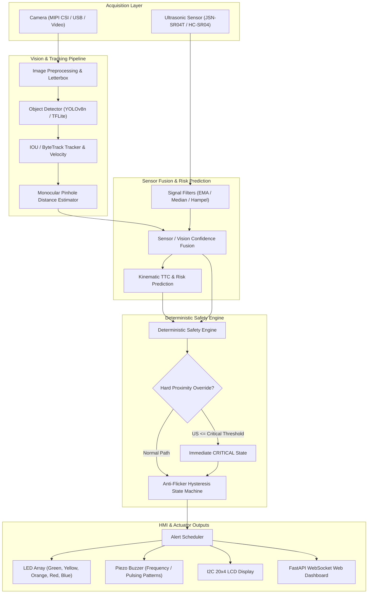

# KPIT Parking Assist V2.0 🚗🛡️

<div align="center">

[](https://www.python.org/)
[](docs/hardware.md)
[](tests/)
[](dashboard/)
[](vision/)
[](LICENSE)

**An edge-computing parking assistance & obstacle awareness system combining monocular computer vision, ultrasonic distance sensing, real-time sensor fusion, kinematic Time-To-Collision (TTC) prediction, and a deterministic safety state engine.**

[Key Features](#-key-features) •
[Architecture](#-system-architecture) •
[Quick Start](#-quick-start) •
[Simulation](#-simulation-mode) •
[Hardware & Wiring](#-hardware-setup--wiring) •
[Tinker Board Deployment](#-tinker-board-deployment) •
[Testing](#-testing--safety-verification) •
[Documentation](#-documentation)

---

</div>


## 🌟 Highlights & Innovations

- **Deterministic Safety Supremacy**: AI and ML models provide advisory risk scoring, but **hard deterministic safety logic always retains absolute veto authority**. If the ultrasonic sensor measures critical proximity, safety escalation triggers instantly regardless of camera confidence or ML predictions.
- **Sensor & Vision Confidence Fusion**: Cross-validates monocular vision bounding-box distance estimates against ultrasonic time-of-flight measurements with automatic disagreement detection and conservative fallback.
- **Dynamic Kinematic Tracking & TTC**: Integrates an IOU / ByteTrack object tracker with moving-average velocity computation to predict **Time-To-Collision (TTC)** in real time.
- **Anti-Flicker Hysteresis State Machine**: Prevents zone oscillation and noisy alerts near boundary thresholds through configurable persistence filters (`SAFE` → `CAUTION` → `WARNING` → `CRITICAL` / `FAULT`).
- **Headless Live Telemetry Dashboard**: Built-in FastAPI + WebSocket web dashboard streaming 30 FPS telemetry, per-stage pipeline latencies, system health (CPU, RAM, Temp), and interactive alert indicators directly to any browser.
- **Automated Graceful Fallback**: Hardware-agnostic runtime that automatically falls back to simulated/mock backends if physical cameras, GPIO sensors, or displays are disconnected during bench testing.

---

## 📐 System Architecture



### Safety Authority Hierarchy

```
[1] Sensor Health & Signal Integrity        (HIGHEST PRIORITY - FAULT on dropout)
       ↓
[2] Hard Ultrasonic Safety Limits           (Unconditional override: US <= 0.5m → CRITICAL)
       ↓
[3] Cross-Sensor Validation & Fusion        (Conservative resolution on disagreement)
       ↓
[4] Kinematic Time-To-Collision (TTC)       (Fast approach triggers proactive escalation)
       ↓
[5] ML Advisory Risk Scoring                (Advisory only - never vetoes hard safety)
       ↓
[6] Hysteresis State Machine                (Enforces persistence before de-escalation)
       ↓
[7] Alert Scheduler & Actuators             (LOWEST PRIORITY - LED, Buzzer, LCD, Dashboard)
```

---

## ⚡ Quick Start

### Prerequisites
- Python 3.10, 3.11, or 3.12
- Linux (Debian / Ubuntu / TinkerOS), macOS, or Windows

### 1. Installation

Clone the repository and install dependencies:

```bash
git clone https://github.com/officialayush5839-arch/parking-assist-v2.git
cd parking-assist-v2

# Install standard dependencies
pip install -r requirements.txt
```

*(Optional: for YOLO detection, install `pip install ultralytics opencv-python`)*

### 2. One-Click Verification Scripts

Pre-configured run scripts are provided for both Windows (`.bat`) and Linux/macOS (`.sh`):

| Action | Windows | Linux / macOS / TinkerOS |
| :--- | :--- | :--- |
| **Run Unit & Integration Tests** | `run_tests.bat` | `bash run_tests.sh` |
| **Interactive Showcase Demo** | `run_demo.bat` | `bash run_demo.sh` |
| **Run Dynamic Simulation** | `run_simulation.bat` | `bash run_simulation.sh` |
| **Launch Live Web Dashboard** | `run_dashboard.bat` | `python -m app.main --mode simulation --dashboard` |
| **Hardware-Independent Self-Test** | `run_selftest.bat` | `bash run_selftest.sh` |

---

## 🎮 Simulation Mode (Zero Hardware Needed)

Test every safety zone, scenario, and failure mode on your laptop without any connected sensors or cameras:

```bash
# Standard simulation
python -m app.main --mode simulation

# Test hard safety override with critical ultrasonic reading
python -m app.main --mode simulation --scenario critical_distance

# Test high-speed approaching obstacle with TTC escalation
python -m app.main --mode simulation --scenario vehicle_approaching_fast

# Test sensor disagreement (Vision reports 4.0m, Ultrasonic reports 0.9m)
python -m app.main --mode simulation --scenario sensor_disagreement
```

### Pre-Configured Scenarios

| Scenario | Simulated Conditions | Expected Safety Behavior |
| :--- | :--- | :--- |
| `safe_vehicle_stationary` | Obstacle static at 4.0 m | Holds in `SAFE` zone |
| `vehicle_approaching_slow` | Closing speed ~0.20 m/s | Smooth `SAFE` → `CAUTION` → `WARNING` |
| `vehicle_approaching_fast` | Closing speed ~0.35 m/s | Rapid escalation to `CRITICAL` via TTC |
| `pedestrian_crossing` | Lateral pedestrian motion | Transient `CAUTION` / `WARNING` |
| `ultrasonic_timeout` | Ultrasonic sensor signal drops | Graceful degradation to vision-only tracking |
| `camera_failure` | Camera feed disconnects at t=3s | Continues failsafe operation on ultrasonic |
| `sensor_disagreement` | Ultrasonic: 0.9m vs Vision: 4.0m | **Conservative Warning**: Trust nearest hazard |
| `critical_distance` | Obstacle at 0.30m (no vision) | **Hard Safety Override**: Instant `CRITICAL` |

---

## 📊 Live Web Telemetry Dashboard

Launch the embedded dashboard to inspect real-time metrics over WebSockets:

```bash
python -m app.main --mode demo --dashboard
```

Open your browser at **`http://127.0.0.1:8765`**:
- **Live Safety State**: Color-coded banners (`SAFE`, `CAUTION`, `WARNING`, `CRITICAL`, `FAULT`).
- **Distance Comparison**: Side-by-side Ultrasonic vs. Monocular Vision distance gauges.
- **Kinematics**: Closing velocity ($m/s$) and estimated Time-To-Collision ($s$).
- **Diagnostics**: Pipeline stage latencies (Preprocess, Inference, Track, Fusion) and FPS.
- **Hardware Telemetry**: Real-time CPU usage, RAM utilization, and SoC temperature.

---

## 🔌 Hardware Setup & Wiring

Designed for the **ASUS Tinker Board R2.0 / Raspberry Pi 4** with standard GPIO peripherals:

```
+-----------------------------------------------------------------------+
|                       ASUS TINKER BOARD R2.0                          |
|                                                                       |
|  [MIPI CSI] <====== Camera Ribbon ======> 5MP / 8MP Camera Module     |
|                                                                       |
|  [GPIO Pin 02] 5V Power --------------> LCD VCC / Sensor VCC          |
|  [GPIO Pin 06] GND -------------------> Common Ground                 |
|  [GPIO Pin 03] I2C SDA ---------------> LCD SDA                       |
|  [GPIO Pin 05] I2C SCL ---------------> LCD SCL                       |
|  [GPIO Pin 16] GPIO 16 (TRIG) --------> JSN-SR04T / HC-SR04 Trig      |
|  [GPIO Pin 18] GPIO 18 (ECHO) <-------+ JSN-SR04T Echo (via divider)  |
|  [GPIO Pin 22] GPIO 22 ---------------> Buzzer (+)                    |
|  [GPIO Pin 29] GPIO 29 ---------------> Green LED (Safe)              |
|  [GPIO Pin 31] GPIO 31 ---------------> Yellow LED (Caution)          |
|  [GPIO Pin 33] GPIO 33 ---------------> Orange LED (Warning)          |
|  [GPIO Pin 35] GPIO 35 ---------------> Red LED (Critical)            |
|  [GPIO Pin 37] GPIO 37 ---------------> Blue LED (System Fault)       |
+-----------------------------------------------------------------------+
```

> **Note on 5V Sensors**: When using HC-SR04 or JSN-SR04T ultrasonic sensors with 3.3V GPIO boards (Tinker Board / Raspberry Pi), always use a 1kΩ / 2kΩ voltage divider or logic-level shifter on the **ECHO** line to protect the GPIO input pin.

---

## 🚀 Tinker Board Deployment

A complete production deployment bundle is included in [`parking_assist_v2_tinkerboard_v2.0.0.zip`](deployment/tinkerboard/):

### 1. Copy & Extract onto Tinker Board
```bash
# From development host:
scp parking_assist_v2_tinkerboard_v2.0.0.zip linaro@<TINKER_BOARD_IP>:/home/linaro/

# SSH into the board:
ssh linaro@<TINKER_BOARD_IP>
mkdir -p /opt/parking_assist_v2
unzip parking_assist_v2_tinkerboard_v2.0.0.zip -d /opt/parking_assist_v2
cd /opt/parking_assist_v2
```

### 2. Run Automated Setup
```bash
sudo bash deployment/tinkerboard/install.sh
```
*Installs system dependencies, builds Python virtual environment, installs GPIO/LCD drivers, and registers the systemd daemon.*

### 3. Manage the Background Service
```bash
# Start service
sudo systemctl start parking-assist

# View real-time logs
sudo journalctl -u parking-assist -f

# Check status
sudo systemctl status parking-assist
```

Access the dashboard from any device on the same local network: `http://<TINKER_BOARD_IP>:8765`.

---

## 🧪 Testing & Safety Verification

The project includes an automated test suite with **88 tests** covering unit behavior, multi-sensor integration, edge cases, and performance sanity:

```bash
# Run entire test suite
python -m pytest --import-mode=importlib -q

# Run specific test suites
python -m pytest tests/unit/ -v
python -m pytest tests/integration/ -v
python -m pytest tests/simulation/ -v
```

### Key Verified Invariants
- ✅ `test_hard_safety_override`: Ultrasonic sensor reading $\le 0.50m$ unconditionally triggers `CRITICAL`, even if vision confidence is 0% and ML risk is LOW.
- ✅ `test_ai_cannot_veto_hard_safety`: An advisory neural network model cannot suppress or downgrade a deterministic safety alert.
- ✅ `test_fault_when_both_sources_invalid`: If both camera and ultrasonic sensors disconnect or report invalid metrics, system transitions immediately to `FAULT` (Blue LED).
- ✅ `test_state_machine_hysteresis`: Zone de-escalation requires consistent stable readings over multiple frames to eliminate alert chatter.

---

## 📂 Project Structure

```
parking_assist_v2/
├── app/                  # Main entry point, runtime loop, pipeline orchestrator
├── camera/               # Video backends (USB, MIPI CSI, Video File, Mock) & calibration
├── vision/               # Detection backends (YOLOv8n, TFLite, Mock) & preprocessing
├── tracking/             # Multi-object tracking (IOU, ByteTrack) & velocity estimation
├── distance/             # Monocular pinhole distance & ultrasonic sensor drivers
├── fusion/               # Cross-sensor confidence fusion & disagreement arbitration
├── zone/                 # Deterministic safety engine, hysteresis state machine
├── alerts/               # Multi-LED controller, buzzer pattern scheduler
├── display/              # I2C HD44780 LCD display driver & HMI screen formatter
├── diagnostics/          # Health monitor, latency metrics, system resource monitor
├── datalog/              # Structured JSONL logging (events, sensor telemetry, experiments)
├── dashboard/            # FastAPI backend, WebSocket broadcaster, HTML5/JS UI
├── simulation/           # Simulation engine, scenario registry, synthetic generators
├── deployment/           # Tinker Board install scripts, systemd service, shell wrappers
├── config/               # YAML configs (system, safety thresholds, camera, logging)
├── docs/                 # Detailed architecture, hardware wiring, and testing guides
└── tests/                # 88 pytest unit, integration, simulation, and performance tests
```

---

## 📚 Documentation

For in-depth technical references and deployment runbooks:

- 📖 [Project Master Guide](docs/PROJECT_GUIDE.md) — Comprehensive technical reference manual
- 📖 [Hardware & Wiring Blueprint](docs/hardware.md) — Pinout tables, electrical schematics, and sensor specs
- 📖 [User Deployment Guide](docs/USER_DEPLOYMENT_GUIDE.md) — Step-by-step edge device installation
- 📖 [Troubleshooting Runbook](docs/TROUBLESHOOTING.md) — Common issues, camera debugging, and GPIO diagnostics
- 📖 [Verification Matrix](docs/VERIFICATION_MATRIX.md) — Complete requirement verification audit
- 📖 [Final Release Readiness Report](docs/FINAL_RELEASE_READINESS_REPORT.md) — Release audit and readiness checklist

---

## 📄 License

This project is licensed under the **MIT License** — see the [LICENSE](LICENSE) file for details.
